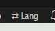
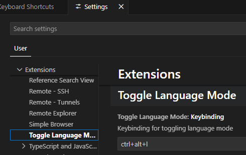

# Toggle Language Mode

A tiny VS Code extension that adds a status bar button to quickly switch the
active editor between **YAML** and **CloudFormation** language mode.

## Features

- One-click switch between `yaml` and `cloudformation` via a status bar item.
- Keybinding `Ctrl+Alt+L` (`Cmd+Alt+L` on macOS).
- Status bar label reflects the current language.

## Requirements

- The `cloudformation` language is provided by the [AWS Toolkit](https://marketplace.visualstudio.com/items?itemName=AmazonWebServices.aws-toolkit-vscode)
  extension and/or `cfn-lint`.
- The `yaml` language is provided by the Red Hat YAML extension or any other
  YAML extension.

## Usage

- Click the `⇄ YAML` / `⇄ CFN` status bar button, or
- press `Ctrl+Alt+L` (`Cmd+Alt+L` on macOS) while an editor is focused.

The keybinding can be changed in **Keyboard Shortcuts** (`Ctrl+K Ctrl+S`) by
searching for *Toggle Language Mode*.

## Known Issues

- Only the fixed pair `yaml` <-> `cloudformation` is supported; the language
  pair is not yet configurable.

## Development

See [docs/DEVELOPMENT.md](docs/DEVELOPMENT.md).

## Publishing

See [docs/PUBLISHING.md](docs/PUBLISHING.md).

## Porting to GitHub

See [docs/PORTING.md](docs/PORTING.md) - contains the interchangeable URLs and
open TODOs (GitHub owner/repo name, publisher ID).

## Release Notes

See [CHANGELOG.md](CHANGELOG.md).

## License

[MIT](LICENSE)
